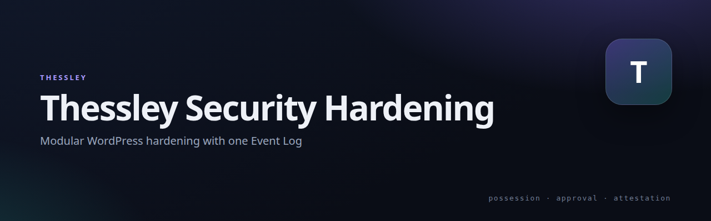

# Thessley Security Hardening

   

[](https://netmate1234.github.io/Thessley/)

Modular WordPress security hardening — perimeter blocking, request inspection, integrity and malware detection, hardening and alerts — with one Event Log across every module.

## Quick install

```sh
wp plugin install https://github.com/netmate1234/thessley-security-hardening/releases/latest/download/thessley-security-hardening-1.0.24.zip --activate
```

Or upload the release zip under **Plugins → Add New → Upload Plugin**.

**Verify:** the **Thessley Security Hardening** menu appears and **Event Log** lists the site's events.

**Lockout prevention:** leave modules in log-only mode while reviewing the Event Log; enable enforcement one module at a time after staging tests. Verify the site's trusted-network and login behavior first, and retain hosting/WP-CLI recovery access. If needed, deactivate `thessley-security-hardening` through WP-CLI or the hosting file manager; do not delete the plugin or its data as the first recovery step. See the [safe install and recovery guide](https://github.com/netmate1234/Thessley/blob/main/docs/wordpress-safe-install.md).

Requirements: WordPress 6.0+, PHP 8.3+.

## What it does

- **Perimeter:** IP blocklist from public feeds, geo blocking, geo-login for `wp-login.php`, per-IP rate limiting.
- **Request inspection:** SQL injection, XSS, traversal and command-injection signatures; failed-login lockout.
- **Detection:** file integrity against WordPress.org checksums, malware signatures, vulnerability scan, user watchdog.
- **Hardening:** removes the tools an attacker reaches for after getting in; security headers; user enumeration.
- **Operations:** one Event Log with severity 1–20, Telegram/email alerts, activity and bot logs, config import/export.

Every module can run in **log-only** or **enforcing** mode, independently — nothing is all-or-nothing.

## Install

1. Upload the `thessley-security-hardening` folder to `wp-content/plugins/`, or install the zip from [Releases](https://github.com/netmate1234/thessley-security-hardening/releases).
2. Activate it, then open **Thessley Security Hardening** and enable the modules you want.
3. The Event Log records everything regardless of which alerts you configure.

Requires WordPress 6.0+ and PHP 8.3+. No external service is called unless you configure one.

## Related

- [Thessley](https://github.com/netmate1234/Thessley) — the project family and overview deck
- [Thessley Passkey](https://github.com/netmate1234/thessley-passkey-wordpress) — the passwordless login plugin (split out of this one in 1.0.24)

## License

GPL-2.0-or-later.
